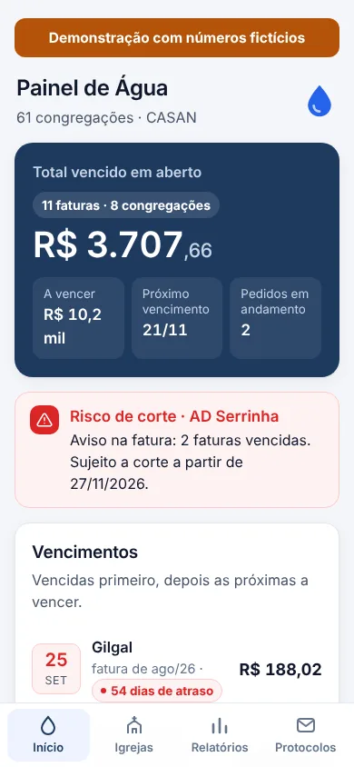
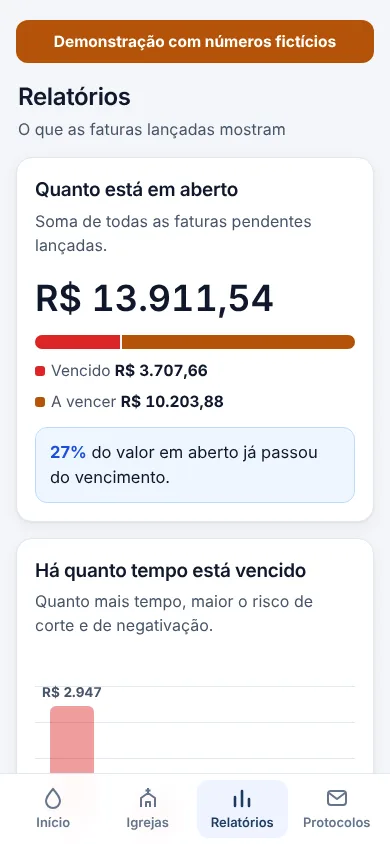

# Painel de Água

**Um painel para o celular que acompanha as faturas de água de 61 congregações: o que está vencido, o que vence em seguida, quem está consumindo acima da média e o que foi pedido à CASAN.**

**Demonstração:** https://marcosdev0109.github.io/painel-agua/

> Esta é a versão pública. Os nomes das congregações são reais. Matrículas, documentos, valores, consumos, datas e protocolos são **fictícios**, gerados em `src/data/demo.js`. Os dados reais ficam fora do repositório.

<p>
  
  
  
  
</p>

---

## Estudo de caso

### O problema

Eu trabalho na administração da Assembleia de Deus em Florianópolis e cuido das contas de água e luz das congregações. São 61 unidades consumidoras na CASAN.

Antes do painel, tudo era manual:

- entrar no portal da CASAN unidade por unidade para ver se havia fatura pendente;
- baixar a 2ª via e comparar o consumo com os meses anteriores;
- perceber qual fatura veio alta, abrir pedido de revisão ou de parcelamento;
- depois, procurar a resposta da CASAN no meio do e-mail.

Na prática, uma fatura alta só era notada quando alguém da congregação avisava, ou quando chegava o aviso de corte. Uma das unidades chegou a ter a água cortada por faturas acumuladas.

**Antes: cerca de 20 horas por mês. Com o painel: cerca de 4.**

### O que eu construí

Um painel mobile-first, porque é no celular que eu acompanho tudo durante a semana. Ele tem quatro telas:

| Tela | Para que serve |
| --- | --- |
| **Início** | Total vencido, alertas de corte, próximos vencimentos e maiores valores em aberto. |
| **Congregações** | Busca por nome ou matrícula, filtro por situação e a ficha de cada unidade. |
| **Relatórios** | Dez análises: envelhecimento da dívida, ranking, concentração, consumo acima da média, tendência, custo por m³, composição da fatura e calendário. |
| **Protocolos** | Pedidos feitos à CASAN (revisão, parcelamento, vazamento) e o andamento de cada um. |

Na ficha de cada congregação, cada fatura aparece como um cartão. Embaixo dela fica a solicitação feita à CASAN sobre aquela fatura, com o tipo e se foi deferida ou negada. Assim eu sei na hora se já pedi alguma coisa ou se ainda preciso agir.

### Como os dados chegam ao painel

1. Baixo as faturas pendentes do portal da CASAN.
2. Uso o Claude (IA da Anthropic) para ler os PDFs e extrair os dados de cada fatura.
3. O painel calcula sozinho o resto: o que está vencido, quantos dias de atraso, totais, consumo acima da média e custo por m³.
4. As respostas da CASAN chegam por e-mail e são ligadas ao protocolo e à fatura correspondente.

### Decisões que eu tomei

- **Nunca inventar um valor.** A regra mais importante do projeto. Só entra no painel o que está impresso na fatura. Se falta um dado, a IA pergunta em vez de completar. Tudo o que é calculado (situação, atraso, totais) fica separado, em `src/lib/regras.js`.
- **Só faturas vencidas e a próxima a vencer.** O objetivo é agir no que é urgente, não montar um arquivo histórico.
- **Celular em primeiro lugar.** Letras grandes, botões com pelo menos 44 px, barra de abas no rodapé para usar com o polegar e nada de rolagem para os lados.
- **Cor nunca sozinha.** Vencido é vermelho, mas também vem escrito ("20 dias de atraso"), para quem não distingue bem as cores.
- **Sem biblioteca de gráficos.** Os gráficos são SVG e CSS, para o projeto ficar leve e para eu entender cada linha.
- **Dados reais fora do GitHub.** O repositório público só tem dados de demonstração, gerados de forma determinística e com datas relativas a hoje, para a demo sempre parecer atual.

### O resultado

- O tempo mensal caiu de cerca de 20 para cerca de 4 horas.
- Os riscos de corte aparecem no topo da tela, antes de virar problema.
- O consumo acima da média aparece sozinho, o que ajuda a procurar vazamento antes de pagar ou contestar.

### Como o projeto evoluiu

- **Versão 1** (primeiro commit): um único `index.html` com HTML, CSS e JavaScript puro. Resolveu o problema, mas começou a ficar difícil de mexer.
- **Versão 2** (atual): reescrita em **React com Vite**, separada em componentes, regras e dados. O visual foi redesenhado seguindo boas práticas de UX para sistemas de cobrança (paleta azul-marinho, fontes Lexend e Source Sans 3, ícones em SVG).

O histórico de commits conta essa migração passo a passo.

### Próximos passos

- Importar as faturas direto dos PDFs, sem passar pelo chat.
- Guardar o histórico pago para comparar ano contra ano.
- Incluir as contas de energia (CELESC) no mesmo painel.

---

## Tecnologias

- **React 19** com componentes de função, hooks (`useState`, `useEffect`, `useMemo`, `useRef`) e Context.
- **Vite** para desenvolvimento e build.
- **CSS puro** com variáveis, tema claro e escuro automático e `prefers-reduced-motion`.
- **SVG** para os gráficos e ícones.
- **GitHub Actions** para publicar no GitHub Pages a cada push.
- **IA (Claude)** para extrair os dados das faturas e no desenvolvimento: usei o Claude para planejar, programar e revisar o código comigo.

## Estrutura

```
src/
├── App.jsx               navegação entre as telas e a ficha aberta
├── PainelContext.js      dados compartilhados entre as telas
├── components/
│   ├── Inicio.jsx        resumo, alertas e vencimentos
│   ├── Igrejas.jsx       busca, filtros e lista
│   ├── Ficha.jsx         faturas, solicitações, consumo e protocolos
│   ├── Relatorios.jsx    os dez relatórios
│   ├── Protocolos.jsx    pedidos feitos à CASAN
│   ├── Comuns.jsx        agenda, barras e peças reutilizadas
│   ├── Abas.jsx          barra de abas
│   └── Icones.jsx        ícones em SVG
├── lib/
│   ├── regras.js         situação, atraso, totais e protocolos
│   └── formato.js        moeda, datas e meses em português
└── data/
    ├── congregacoes.js   as 61 unidades
    └── demo.js           dados fictícios da demonstração
```

## Como rodar

```bash
npm install
npm run dev
```

Para gerar a versão de produção: `npm run build`.

## Autor

João Marcos Rodrigues Barbosa · [GitHub](https://github.com/Marcosdev0109) · [LinkedIn](https://www.linkedin.com/in/joao-marcos01) · [Portfólio](https://marcosdev0109.github.io)
